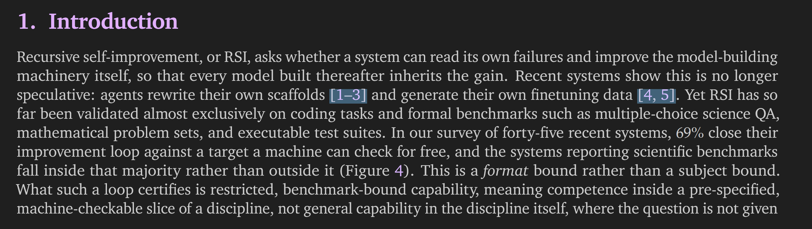
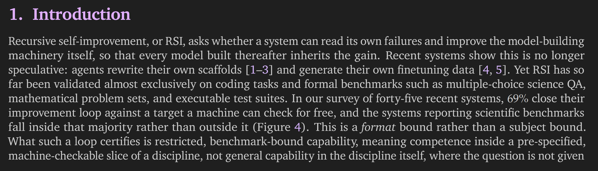

# Zotero 10 Hide Citation Highlights

A Zotero 10 plugin by [XuebaStudy](https://github.com/XuebaStudy). It hides persistent blue backgrounds on citations and matched internal cross-reference links in the PDF reader while preserving clickable links, hover feedback, and citation previews.

## Before and after

Hide persistent blue citation backgrounds while keeping links clickable, with hover feedback and citation previews preserved.

| Before — plugin disabled | After — plugin enabled |
| :---: | :---: |
|  |  |

## Main improvements

- **Updated rendering support:** Handles `Page._pushOverlays()` for the DOM display list in Zotero 10.0.3, in addition to the earlier `Renderer._drawOverlays()` implementation.
- **Refresh and restoration:** Refreshes existing pages after hiding citation backgrounds and restores the original methods when disabled. Preserves user annotations, search highlights, and hover feedback.
- **Compatibility declaration:** Raises the maximum supported version from `9.0.*` to `10.0.*` and retains the Zotero 7–9 code path.
- **Lifecycle handling:** Prevents duplicate polling timers and correctly clears a timer whose ID is 0.
- **Windows build:** Provides `build.ps1` for packaging without a separate ZIP utility.
- **Independent updates:** Uses this repository's plugin ID and update URL.

See [CHANGELOG.md](CHANGELOG.md) for details.

## Compatibility and verification scope

The primary target is **Zotero 10.0.3**. Its locally installed reader code has been inspected, and automated checks using its actual Page rendering methods cover hiding, repeated scans, new pages, preservation of link data, restoration, and re-enabling. The package contents have also been checked.

Installation and interaction have not yet been verified in the Zotero interface. The Zotero 7–9 implementation has not been retested here. This plugin depends on internal reader methods and may need changes after future Zotero updates. The current adaptation targets the standard PDF view; support for the new reading mode, EPUB, or web snapshots is not claimed.

## Installation and migration

GitHub Actions builds ready-to-install `.xpi` packages in the cloud. Download `zotero10-hide-citation-highlights.xpi` from [Releases](https://github.com/XuebaStudy/zotero10-hide-citation-highlights/releases) when a version has been published. If no release package is available, download a cloud build using the instructions below, or [build locally](#local-build).

1. If the upstream plugin is installed, disable or uninstall it first to avoid both plugins modifying the reader.
2. In Zotero, open **Tools → Plugins → Gear menu → Install Plugin From File**.
3. Select `zotero10-hide-citation-highlights.xpi` from a release, an extracted cloud build, or a local build.
4. Open a PDF containing citation links and wait about one second. The blue boxes should disappear, and links should remain clickable.

This version uses the independent ID `zotero10-hide-citation-highlights@XuebaStudy` and does not automatically replace the upstream plugin. It does not remove PDF links or modify library data. Disabling it should restore the blue boxes; if a page does not refresh, close and reopen the PDF.

## Cloud build download

1. Open [Actions → Build](https://github.com/XuebaStudy/zotero10-hide-citation-highlights/actions/workflows/build.yml) and select a successful run for the branch or commit you want to install.
2. In **Artifacts**, download `plugin-ubuntu-latest` or `plugin-windows-latest`. Both contain the same plugin files and can be installed on any supported operating system.
3. Extract the downloaded ZIP and install the included `zotero10-hide-citation-highlights.xpi` in Zotero.

You must be signed in to GitHub to download Actions artifacts. Build artifacts are retained for 7 days. Repository maintainers can trigger a fresh build with **Run workflow**; pushes and pull requests also trigger builds automatically.

## Local build

On Windows, run PowerShell from the repository directory:

```powershell
.\build.ps1
```

The current output is `zotero10-hide-citation-highlights.xpi`.

On Linux or macOS, use PowerShell 7 with `pwsh -File ./build.ps1`, or a ZIP utility:

```sh
zip -j -X zotero10-hide-citation-highlights.xpi manifest.json bootstrap.js ATTRIBUTION.md COPYRIGHT.md
```

An `.xpi` is a ZIP archive. `manifest.json` and `bootstrap.js` must be at its root; attribution and copyright documents are also included.

To check JavaScript syntax and verify the manifest and package (Node.js and Python 3 required):

```sh
node --check bootstrap.js
python scripts/verify.py --xpi zotero10-hide-citation-highlights.xpi
```

Use `python3` instead of `python` where appropriate. The package check verifies its structure and that all packaged files exactly match the source files.

## Maintenance and releases

Report problems through [this repository's Issues](https://github.com/XuebaStudy/zotero10-hide-citation-highlights/issues).

Before releasing, confirm the Git push target and complete installation testing. This directory may be a source snapshot without Git metadata; in that case, use a proper checkout before running the release helper.

- `.github/workflows/build.yml` checks JavaScript syntax and builds and verifies packages on Ubuntu and Windows for branch pushes, pull requests, and manual runs. It does not publish releases.
- `.github/workflows/release.yml` builds and verifies a package when a stable version tag such as `v0.2.0` is pushed. The tag must match `manifest.json`, and the repository must match the manifest's update URL. Publication requires `contents: write` permission for `GITHUB_TOKEN`; no separate personal access token is required.
- `release.sh` requires Bash, Python 3.9 or later, Node.js, and Git. It checks for a clean checkout and the expected GitHub push target, updates the manifest version, commits the change, and pushes the current branch and version tag. This triggers public release publication. With the repository configured, run it with a version, for example `bash release.sh v0.2.0`. Only stable `X.Y.Z` versions are supported.

Each version release publishes `zotero10-hide-citation-highlights.xpi` and `updates.json`, then refreshes `updates.json` under the stable `release` tag. Release runs share a concurrency group to prevent simultaneous update-pointer writes. The housekeeping release is excluded from the latest-release link. Do not rerun an older release after publishing a newer version, as it would replace the update pointer.

Automatic updates become available only after the update manifest and installation package have actually been published.

## Credits

Based on [jkroes/zotero-hide-citation-highlights](https://github.com/jkroes/zotero-hide-citation-highlights), with Zotero 10 support maintained by XuebaStudy.
